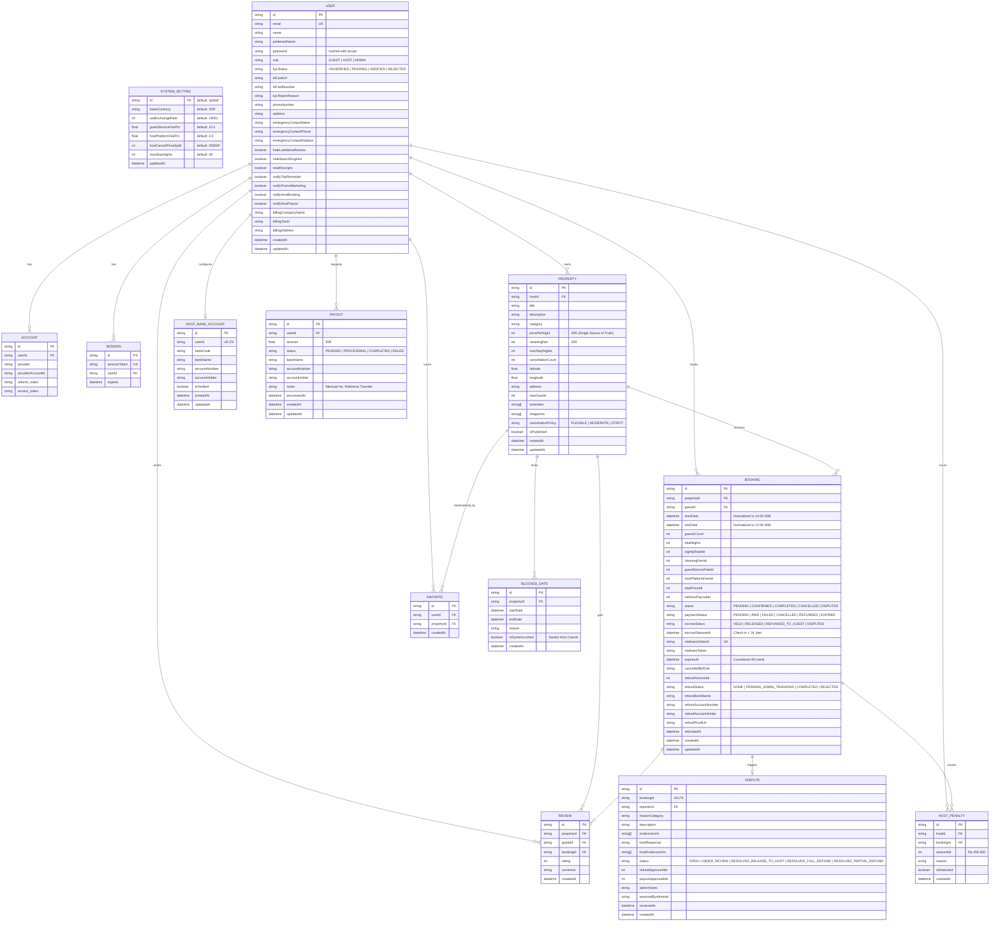
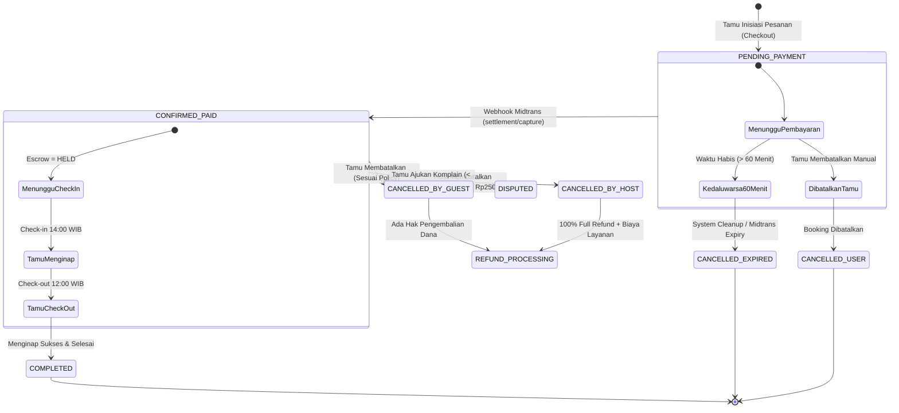
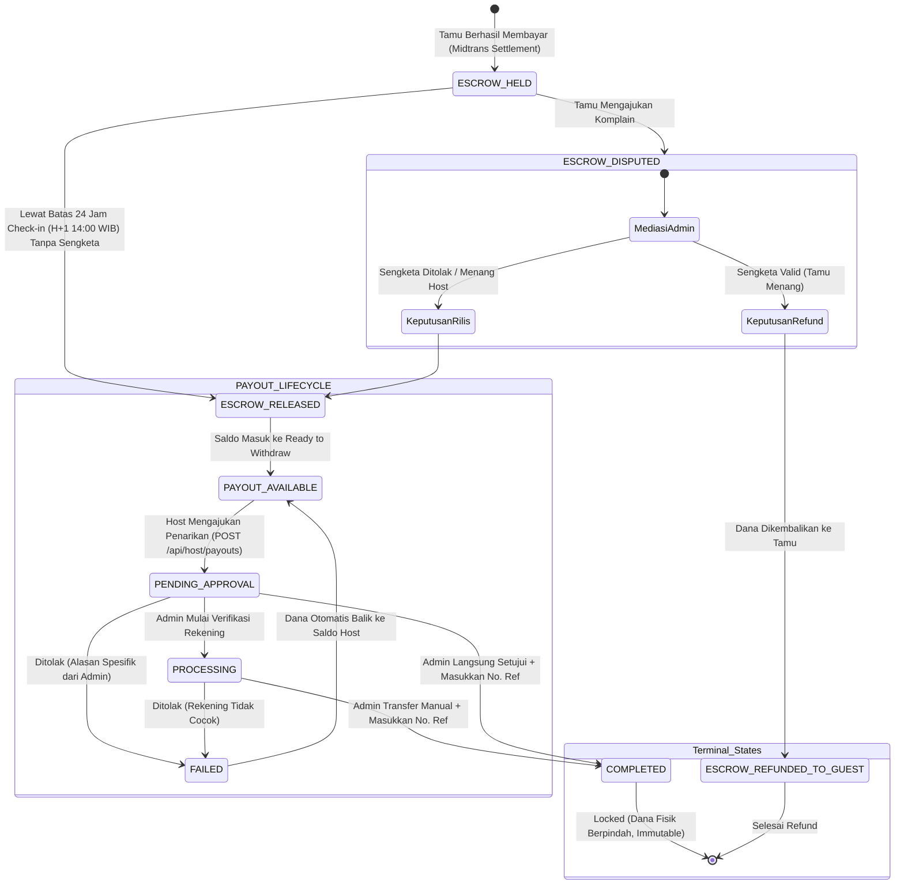
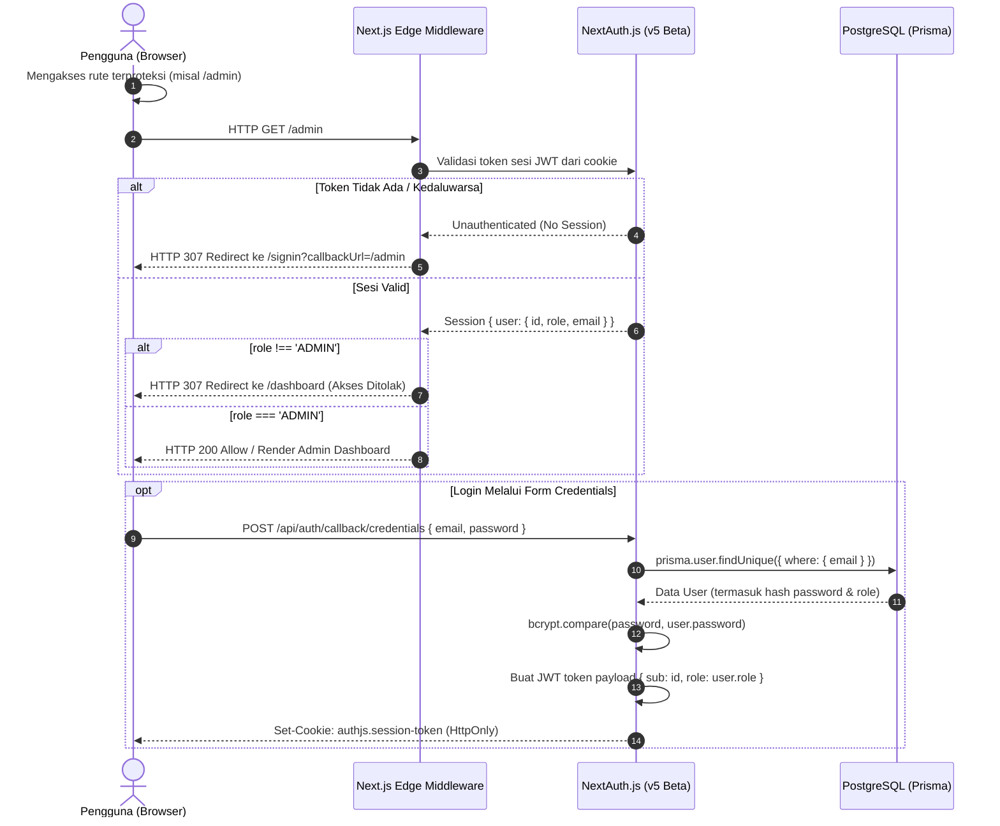
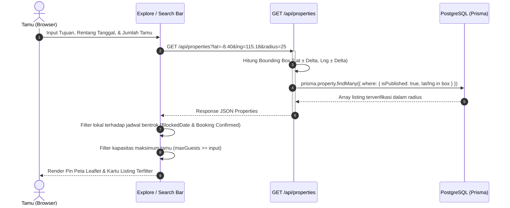
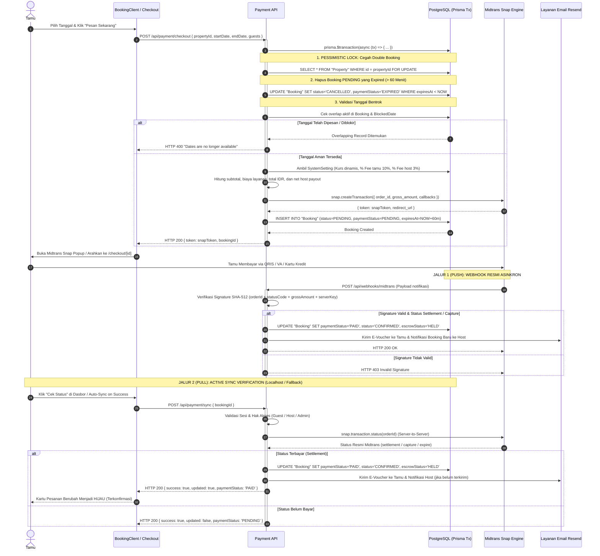
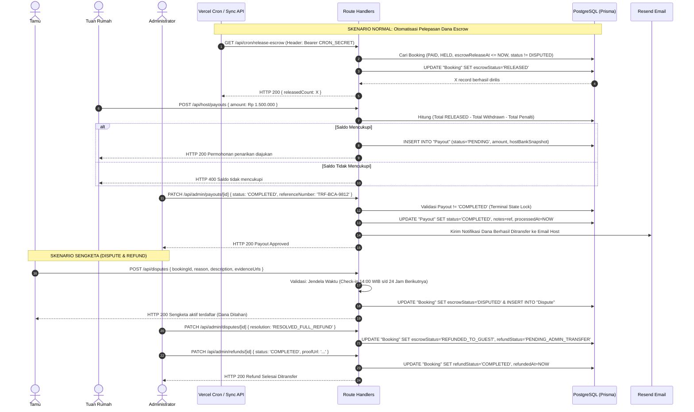
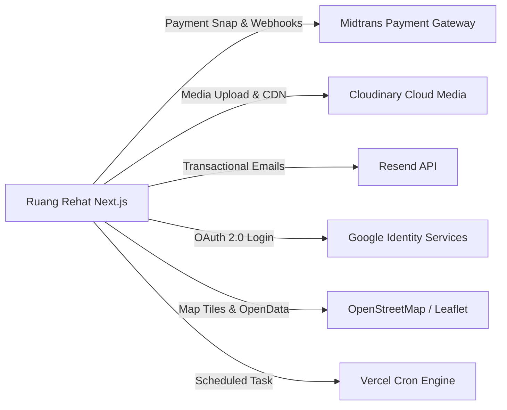

# Arsitektur Teknis & Cetak Biru Sistem: Ruang Rehat

Dokumen ini merupakan cetak biru teknis (*technical architecture blueprint*) resmi dari platform **Ruang Rehat** (aplikasi marketplace akomodasi & *vacation rental* berbasis Next.js App Router, Prisma ORM, PostgreSQL, dan Midtrans Payment Gateway).

---

## 1. Tech Stack & Peta Struktur Direktori

### 1.1 Tech Stack Inti

| Komponen Arsitektur | Teknologi / Pustaka | Versi | Peran & Justifikasi |
| :--- | :--- | :--- | :--- |
| **Framework Web** | Next.js (App Router) | `16.3.8` | Server Components (RSC), Client Components, Server Actions, Route Handlers. |
| **Runtime & Bahasa** | Node.js + TypeScript (Strict) | `Node v20+` / `TS 5.x` | Menjamin *type-safety* end-to-end tanpa toleransi `any`. |
| **Library UI & Render** | React & React DOM | `19.2.8` | React Server Actions, Transition, Suspense, Optimistic Hooks. |
| **Styling & Styling Engine** | Tailwind CSS + tw-animate-css | `4.x` | Utility-first styling dengan PostCSS engine v4 dan Dark/Light mode support via `next-themes`. |
| **Komponen UI Primitif** | Radix UI / Base UI / Lucide | `@base-ui/react`, `lucide-react` | Dialog, Dropdown, Popover, Card, Iconography ramah aksesibilitas (WAI-ARIA). |
| **Database & ORM** | PostgreSQL + Prisma ORM | `@prisma/client 5.22.0` | Skema relasional yang kuat, *pessimistic row locking* (`FOR UPDATE`), transaksi atomik (`$transaction`). |
| **Autentikasi & Sesi** | Auth.js (NextAuth.js v5 beta) | `5.0.0-beta.32` | Sesi berbasis JWT, Credentials Provider (Bcrypt), Google OAuth 2.0, Role-Based Access Control. |
| **Payment Gateway** | Midtrans Snap API | `midtrans-client 1.4.3` | Pembayaran multichannel (QRIS, VA Bank Transfer, Kartu Kredit) dengan verifikasi signature SHA-512. |
| **Penyimpanan Media (Media CDN)**| Cloudinary SDK | `cloudinary 2.11.0` | Unggah foto akomodasi, dokumen identitas KTP (KYC), serta bukti transfer refund manual. |
| **Layanan Email Transaksional**| Resend | `resend 6.32.0` | Pengiriman tiket e-voucher tamu, notifikasi pesanan masuk ke host, dan bukti transfer payout. |
| **Peta Interaktif** | Leaflet & React-Leaflet | `leaflet 1.9.4` | Visualisasi koordinat geografis properti dan pencarian berbasis *bounding box*. |
| **Manajemen Tanggal** | date-fns & date-standards | `date-fns 4.4.0` | Penanganan waktu terpusat Zona Waktu Indonesia Barat (WIB / UTC+7). |

---

### 1.2 Peta Struktur Direktori & Hasil Modularisasi

Arsitektur direktori dirancang dengan prinsip pemisahan tanggung jawab (*Separation of Concerns*), isolasi domain, dan dekomposisi komponen (setiap komponen < 250 baris kode):

```text
airbnb-projects/
├── prisma/
│   └── schema.prisma              # Definisi skema database, tabel, relasi, indeks, dan enum
├── public/                        # Aset statis, ikon kategori, logo platform
└── src/
    ├── app/                       # Next.js App Router (Halaman, Layout, dan API Handlers)
    │   ├── actions/               # Server Actions (Mutasi preferensi, profil, billing, keamanan)
    │   │   └── preferences.ts
    │   ├── admin/                 # Portal Dasbor Administrator (/admin)
    │   │   ├── components/        # Subkomponen Admin (Sidebar, Navigation)
    │   │   │   ├── dialogs/       # Dialog resolusi sengketa, penolakan KYC, approval payout, refund
    │   │   │   ├── settings/      # Simulator kalkulator komisi dinamis
    │   │   │   └── tabs/          # Tab domain: Overview, Bookings, Payouts, KYC, Disputes, Refunds, Users
    │   │   └── page.tsx           # Entry point multi-tab portal admin
    │   ├── api/                   # RESTful Route Handlers (Backend API)
    │   │   ├── admin/             # API privat khusus Administrator (Role verification)
    │   │   ├── auth/              # Handler NextAuth.js [...nextauth] dan registrasi kredensial
    │   │   ├── bookings/          # Query pesanan, inisialisasi, dan pembatalan bersyarat
    │   │   ├── cron/              # Endpoint cron Vercel (Otomatisasi pelepasan escrow 24 jam)
    │   │   ├── disputes/          # Pengajuan sengketa oleh tamu dan review host
    │   │   ├── favorites/         # Manajemen wishlist / favorit tamu
    │   │   ├── host/              # Inquiry rekening bank, pengelolaan penarikan dana host (payout)
    │   │   ├── kyc/               # Endpoint pengunggahan & pengajuan verifikasi KTP host
    │   │   ├── payment/           # Checkout Midtrans Snap token, active sync verification, dan proteksi bypass
    │   │   ├── properties/        # Endpoint query listing, filter geospasial, dan kalender diblokir
    │   │   ├── reviews/           # Pengiriman ulasan & rating pasca-menginap
    │   │   ├── upload/            # Upload file multipart ke Cloudinary
    │   │   ├── user/              # Ekspor data pribadi (Hak Subjek Data UU PDP)
    │   │   └── webhooks/          # Webhook penerima notifikasi resmi Midtrans
    │   ├── bookings/[id]/voucher/ # Halaman E-Voucher resmi & cetak tiket reservasi (VoucherClient)
    │   ├── checkout/[id]/         # Halaman pembayaran tamu (Integrasi Midtrans Snap CheckoutClient)
    │   ├── dashboard/             # Portal Dasbor Pengguna (Guest & Host)
    │   │   └── components/        # Komponen modular: TripCard, BankAccountForm, PayoutBalanceCards
    │   ├── profile/               # Manajemen Profil, Privasi UU PDP, Preferensi, & Penagihan Bisnis
    │   │   └── components/        # Dekomposisi per tab: PersonalInfo, Security, Privacy, Hosting
    │   ├── properties/            # Listing properti, pembuatan properti baru (/new), dan edit
    │   │   └── [id]/components/  # Subkomponen modular: DatePicker, GuestPicker, PriceBreakdown
    │   ├── signin/                # Form autentikasi terpadu (Credentials & OAuth)
    │   ├── layout.tsx             # Root layout: ThemeProvider, Navbar, Footer, Skrip Midtrans Snap
    │   └── page.tsx               # Homepage marketplace: Banner pencarian, filter kategori, kartu listing
    ├── components/                # Komponen UI Global yang dapat digunakan kembali
    │   ├── bookings/              # Modal pembatalan pesanan & pelaporan sengketa
    │   ├── calendar/              # Kalender dwibulan, kalkulator fleksibilitas tanggal, guest counter
    │   ├── properties/            # Form pendaftaran akomodasi bertahap & upload galeri
    │   └── ui/                    # Primitif desain sistem (Button, Card, Dialog, Badge status, Dropdown)
    ├── lib/                       # Modul Inti & Utilitas Logika Bisnis
    │   ├── constants.ts           # Nilai default sistem, batas durasi, toleransi waktu
    │   ├── date-standards.ts      # Standarisasi Operasional WIB (UTC+7), jam check-in/out resmi
    │   ├── dictionary.ts          # Sistem lokalisasi dwibahasa (ID / EN)
    │   ├── format.ts              # Format mata uang IDR/USD, angka desimal, format string
    │   ├── notifications.ts       # Integrasi email transaksional Resend
    │   ├── prisma.ts              # Global singleton client Prisma
    │   ├── settings.ts            # Dynamic system settings resolver & kalkulator finansial deterministik
    │   └── utils.ts               # Merger Tailwind class via clsx & twMerge
    ├── middleware.ts              # Edge Middleware pengamanan rute portal `/admin` dan API `/api/admin`
    └── types/                     # Definisi kontrak tipe TypeScript terpusat
        ├── admin.types.ts
        ├── booking.types.ts
        ├── finance.types.ts
        ├── property.types.ts
        └── user-kyc.types.ts
```

---

## 2. Entity Relationship Diagram (ERD)

Visualisasi skema relasional PostgreSQL yang dikelola oleh Prisma ORM. Menunjukkan relasi entitas, integritas referensial (`ON DELETE CASCADE`), kunci utama (`PK`), kunci tamu (`FK`), dan `enum` status penting.



---

## 3. State Machine Diagram (Siklus Hidup Status)

### 3.1 Siklus Hidup Status Reservasi & Pembayaran

Menggambarkan transisi `BookingStatus` dan `PaymentStatus` dari inisiasi checkout hingga kepulangan tamu atau pembatalan.



---

### 3.2 Siklus Hidup Dana Escrow & Penarikan Dana Host (Payout)

Menerapkan **Single Source of Truth** saldo dan **Terminal State Lock** pada pencairan dana:



---

### 3.3 Siklus Hidup Verifikasi KYC & Penyelesaian Sengketa (Dispute)

```mermaid
stateDiagram-v2
    [*] --> UNVERIFIED : User Mendaftar Akun Baru
    
    UNVERIFIED --> PENDING : Host Unggah Foto KTP & Nomor Identitas
    
    state PENDING {
        [*] --> AntreanAuditAdmin
    }

    PENDING --> VERIFIED : Admin Menyetujui (Listing Draft Otomatis Publik)
    PENDING --> REJECTED : Admin Menolak (Wajib Alasan Penolakan Jelas)
    
    REJECTED --> PENDING : Host Memperbaiki Data & Upload Ulang KTP
    VERIFIED --> [*] : Host Aktif Terverifikasi

    --

    state SIKLUS_SENGKETA {
        [*] --> DISPUTE_OPEN : Tamu Unggah Bukti (< 24 Jam sejak 14:00 WIB)
        DISPUTE_OPEN --> UNDER_REVIEW : Host Memberikan Tanggapan / Admin Menginvestigasi
        
        UNDER_REVIEW --> RESOLVED_RELEASE_TO_HOST : Sengketa Ditolak (100% Hak Host)
        UNDER_REVIEW --> RESOLVED_FULL_REFUND : 100% Full Refund Tamu (Host Gagal Layanan)
        UNDER_REVIEW --> RESOLVED_PARTIAL_REFUND : Kompensasi Proporsional Sebagian
        
        RESOLVED_RELEASE_TO_HOST --> Sengketa_Selesai
        RESOLVED_FULL_REFUND --> Sengketa_Selesai
        RESOLVED_PARTIAL_REFUND --> Sengketa_Selesai
    }
    Sengketa_Selesai --> [*]
```

---

## 4. Sequence Diagram - Alur Kritis

### 4.1 Alur Autentikasi & Pengecekan Hak Akses (RBAC)



---

### 4.2 Alur Pencarian, Filter Tanggal/Tamu, & Peta Interaktif



---

### 4.3 Alur Reservasi, Penguncian Tanggal (Pessimistic Lock), Pembayaran, & Dual-Verification System (Push + Pull)



---

### 4.4 Alur Pencairan Dana Host (Escrow Release -> Payout) & Penanganan Sengketa (Dispute)



---

## 5. Matriks Hak Akses (RBAC) & Keamanan Rute

Platform membagi hak akses ke dalam 3 hierarki peran (*Role*) dan 1 status verifikasi kelayakan (*KycStatus*):

| Sumber Daya / Fitur | Tamu Murni (`GUEST`) | Host Belum KYC (`HOST` / Unverified) | Host Terverifikasi (`HOST` / Verified) | Administrator (`ADMIN`) | Mekanisme Proteksi |
| :--- | :---: | :---: | :---: | :---: | :--- |
| **Jelajah & Cari Listing** | ✅ Diizinkan | ✅ Diizinkan | ✅ Diizinkan | ✅ Diizinkan | Publik |
| **Reservasi & Checkout** | ✅ Diizinkan | ✅ Diizinkan | ✅ Diizinkan | ✅ Diizinkan | Sesi Login Wajib (`auth()`) |
| **Membatalkan Pesanan Sendiri** | ✅ Diizinkan | ✅ Diizinkan | ✅ Diizinkan | ✅ Diizinkan | Hak kepemilikan data (`booking.guestId === user.id`) |
| **Mengajukan Sengketa (< 24 Jam)** | ✅ Diizinkan | ❌ Terlarang | ❌ Terlarang | ❌ Terlarang | Validasi kepemilikan & batas waktu check-in + 24 jam |
| **Daftar Properti Baru** | ⚠️ Auto-Upgrade Role | ⚠️ Disimpan DRAFT | ✅ Langsung Tayang | ✅ Langsung Tayang | `isPublished = kycStatus === 'VERIFIED'` |
| **Kelola Rekening Bank Host** | ❌ Terlarang | ✅ Diizinkan | ✅ Diizinkan | ✅ Diizinkan | Sesi Host Login |
| **Tarik Saldo Payout** | ❌ Terlarang | ⚠️ Diblokir (Wajib KYC) | ✅ Diizinkan | ✅ Diizinkan | Validasi Saldo `RELEASED` & Rekening Bank Terdaftar |
| **Dasbor Admin (`/admin`)** | ❌ Ditolak (Redirect) | ❌ Ditolak (Redirect) | ❌ Ditolak (Redirect) | ✅ Akses Penuh | Middleware (`src/middleware.ts`) + Role Check |
| **Audit KYC Host** | ❌ Terlarang | ❌ Terlarang | ❌ Terlarang | ✅ Akses Penuh | Endpoint `/api/admin/kyc/[id]` |
| **Approve / Reject Payout** | ❌ Terlarang | ❌ Terlarang | ❌ Terlarang | ✅ Akses Penuh | Endpoint `/api/admin/payouts/[id]` |
| **Ekspor Subscriber Promo CSV** | ❌ Terlarang | ❌ Terlarang | ❌ Terlarang | ✅ Akses Penuh | Endpoint `/api/admin/marketing/subscribers` |
| **Ekspor Data Pribadi (UU PDP)** | ✅ Diizinkan | ✅ Diizinkan | ✅ Diizinkan | ✅ Diizinkan | Sesi Pribadi (`/api/user/export-data`) |

### Mekanisme Keamanan Berlapis

1. **Edge Middleware Guard (`src/middleware.ts`):** Mengadang akses ilegal ke seluruh rute `/admin/*` dan `/api/admin/*` sebelum masuk ke runtime rendering.
2. **Server-Side Session Check:** Setiap Route Handler memverifikasi token sesi `await auth()`.
3. **Database Row-Level Integrity:** Pemeriksaan eksplisit bahwa `record.userId === session.user.id` sebelum mutasi data dijalankan.
4. **Signature Hashing:** Webhook pembayaran Midtrans diverifikasi menggunakan enkripsi SHA-512 dengan `MIDTRANS_SERVER_KEY`.
5. **Dual-Channel Payment Verification (Push + Pull):** Konfirmasi status pembayaran `PAID` dan `CONFIRMED` diisolasi secara ketat pada 2 saluran terverifikasi: Webhook resmi ber-signature SHA-512 (Push) atau Active Query Server-to-Server ke Midtrans API via `/api/payment/sync` (Pull). Endpoint manipulasi langsung sisi klien (`/api/payment/success`) dinonaktifkan permanen (HTTP 405).

---

## 6. Katalog API Routes & Server Actions

### 6.1 Server Actions (`src/app/actions/preferences.ts`)

| Nama Fungsi | Parameter Utama | Akses Minimal | Kegunaan & Efek Mutasi |
| :--- | :--- | :--- | :--- |
| `updateProfile` | `FormData` (nama, telp, alamat, kontak darurat) | Logged-in User | Memperbarui identitas pribadi, kontak darurat, dan preferensi bahasa/kurs. |
| `changeEmail` | `newEmail`, `currentPassword` | Logged-in User | Mengubah email akun setelah memverifikasi kecocokan kata sandi lama via bcrypt. |
| `changePassword` | `currentPassword`, `newPassword` | Logged-in User | Mengganti kata sandi login pengguna (minimal 6 karakter). |
| `updatePrivacySettings` | `hideLastNameReview`, `hideSearchEngines`, `readReceipts` | Logged-in User | Menyesuaikan pengaturan perlindungan data pribadi sesuai UU PDP. |
| `updateNotificationSettings`| `notifyTripReminder`, `notifyPromoMarketing`, dll. | Logged-in User | Mengatur opt-in email pemberitahuan pesanan, promosi, dan payout. |
| `updateBusinessBilling` | `billingCompanyName`, `billingTaxId`, `billingAddress` | Logged-in User | Menyimpan data NPWP dan nama entitas korporat untuk e-voucher resmi. |

---

### 6.2 RESTful API Routes (`src/app/api`)

| Metode | Jalur Endpoint (`Path`) | Hak Akses | Parameter / Body Utama | Deskripsi Tugas |
| :---: | :--- | :---: | :--- | :--- |
| `POST` | `/api/auth/register` | Publik | `name, email, password` | Registrasi akun baru, hashing password, inisiasi role `GUEST`. |
| `GET` | `/api/properties` | Publik | `lat, lng, radius` | Pencarian listing akomodasi aktif berdasarkan koordinat geografis. |
| `POST` | `/api/properties` | User (Host) | Payload properti, fasilitas, foto | Mendaftarkan properti baru (status draft jika belum KYC). |
| `GET` | `/api/properties/[id]` | Publik | `id` (Path param) | Detail lengkap akomodasi beserta riwayat ulasan terverifikasi. |
| `POST` | `/api/payment/checkout` | Logged-in User | `propertyId, startDate, endDate, guests` | Penguncian tanggal (FOR UPDATE), pembuatan token Midtrans Snap dengan callback URL, dan sinkronisasi `midtransOrderId`. |
| `POST` | `/api/payment/sync` | Guest / Host / Admin | `bookingId` | Active Query Server-to-Server ke status transaksi Midtrans API (Dual-Verification), pembaruan atomik status `PAID`, dan pengiriman email notifikasi. |
| `POST` | `/api/payment/success` | *Disabled* | - | Dinonaktifkan (405) demi keamanan. Status pembayaran murni diproses via webhook Midtrans atau query resmi `/api/payment/sync`. |
| `POST` | `/api/webhooks/midtrans` | Midtrans Server| Payload notifikasi Midtrans | Webhook resmi pembaruan status transaksi via signature SHA-512. |
| `PATCH`| `/api/bookings/[id]/cancel` | Guest / Host | `cancelReason, bankDetails` | Pembatalan pesanan terstruktur (perhitungan penalti & refund). |
| `GET` | `/api/host/payouts` | Host | - | Mengambil riwayat payout, saldo tertahan (HELD), dan saldo siap tarik. |
| `POST` | `/api/host/payouts` | Host | `amount, notes` | Mengajukan penarikan dana ke rekening bank terdaftar (Status PENDING). |
| `POST` | `/api/kyc/submit` | Host | `idCardUrl, idCardNumber` | Mengajukan verifikasi KTP untuk publikasi listing akomodasi. |
| `POST` | `/api/disputes` | Guest | `bookingId, reason, evidenceUrls` | Pengajuan keluhan resmi tamu dalam 24 jam pertama check-in. |
| `GET` | `/api/cron/release-escrow`| Cron Worker | Header `Authorization: Bearer` | Otomatisasi pelepasan dana escrow jatuh tempo ke saldo host. |
| `PATCH`| `/api/admin/payouts/[id]` | **ADMIN** | `status, referenceNumber, notes` | Persetujuan semi-manual pencairan dana host dengan kunci status. |
| `GET` | `/api/admin/marketing/subscribers` | **ADMIN** | `format=json|csv` | Ekspor data tamu yang opt-in email promosi marketing (CSV/JSON). |
| `PATCH`| `/api/admin/kyc/[id]` | **ADMIN** | `status: VERIFIED|REJECTED, reason` | Verifikasi kelayakan dokumen identitas KTP mitra host. |
| `PATCH`| `/api/admin/disputes/[id]`| **ADMIN** | `resolution, refundApprovedIdr` | Resolusi sengketa oleh admin (Full refund / Partial / Release host). |
| `PATCH`| `/api/admin/refunds/[id]` | **ADMIN** | `status: COMPLETED, proofUrl` | Konfirmasi transfer manual pengembalian dana ke rekening tamu. |
| `GET` | `/api/user/export-data` | Logged-in User | - | Ekspor berkas JSON seluruh riwayat data akun (Kepatuhan UU PDP). |

---

## 7. Aturan Bisnis & Kalkulasi Finansial

Seluruh kalkulasi finansial di platform Ruang Rehat menggunakan standar **Pure Integer IDR** (bebas angka pecahan desimal) yang diatur secara terpusat di `src/lib/settings.ts`.

### 7.1 Formula Perhitungan Pemesanan (Booking Financials)

Dihitung berdasarkan parameter dinamis dari tabel `SystemSetting`:

```text
1. Subtotal Sewa Kamar:
   roomSubtotalIdr = nightlyRateIdr × totalNights

2. Biaya Menginap Kotor (Gross Stay):
   grossStayIdr = roomSubtotalIdr + cleaningFeeIdr

3. Biaya Layanan Tamu (Guest Service Fee - Default 10%):
   guestServiceFeeIdr = Math.round(grossStayIdr × (guestServiceFeePct / 100))

4. Total Yang Dibayar Tamu ke Midtrans:
   totalPriceIdr = grossStayIdr + guestServiceFeeIdr

5. Potongan Komisi Platform Host (Host Platform Fee - Default 3%):
   hostPlatformFeeIdr = Math.round(grossStayIdr × (hostPlatformFeePct / 100))

6. Saldo Bersih Yang Menjadi Hak Host (Net Host Payout):
   netHostPayoutIdr = Math.max(0, grossStayIdr - hostPlatformFeeIdr)
```

---

### 7.2 Standar Waktu Operasional (Zona Waktu Indonesia Barat - WIB / UTC+7)

Sesuai ketentuan `src/lib/date-standards.ts`:
- **Waktu Check-in Resmi:** Pukul **14:00 WIB** (`07:00:00 UTC`).
- **Waktu Check-out Resmi:** Pukul **12:00 WIB** (`05:00:00 UTC`).
- **Buffer Pembersihan Kamar:** **2 Jam** (antara 12:00 WIB s/d 14:00 WIB) untuk memastikan properti siap dihuni.
- **Garansi Sengketa Tamu:** **24 Jam** terhitung sejak jam check-in resmi (berakhir H+1 pukul 14:00 WIB).
- **Rilis Dana Escrow:** Otomatis dijadwalkan pada `checkInDate + 24 Jam` (H+1 14:00 WIB).

---

### 7.3 Kebijakan Pembatalan & Hak Pengembalian Dana (Refund)

| Kebijakan | Waktu Pembatalan oleh Tamu | Hak Pengembalian Tamu (% Gross Stay) | Biaya Layanan Tamu | Hak Dana Host |
| :--- | :--- | :---: | :---: | :---: |
| **FLEXIBLE** | $\ge 24$ Jam sebelum Check-in | **100%** | Non-Refundable | Rp 0 |
| **FLEXIBLE** | $< 24$ Jam sebelum Check-in | **50%** | Non-Refundable | 50% |
| **MODERATE** | $\ge 5$ Hari sebelum Check-in | **100%** | Non-Refundable | Rp 0 |
| **MODERATE** | $< 5$ Hari sebelum Check-in | **50%** | Non-Refundable | 50% |
| **STRICT** | $\ge 7$ Hari sebelum Check-in | **50%** | Non-Refundable | 50% |
| **STRICT** | $< 7$ Hari sebelum Check-in | **0% (Hangus)** | Non-Refundable | 100% |

#### Sanksi Pembatalan Sepihak oleh Host:
1. **Pengembalian Dana Tamu:** Tamu menerima pengembalian dana **100% PENUH** (termasuk biaya layanan tamu).
2. **Kunci Kalender Permanen (`isSystemLocked: true`):** Tanggal yang dibatalkan dikunci otomatis agar host tidak dapat menjual kamar secara offline/manual.
3. **Denda Finansial:** Dikenakan penalti Rp 250.000 yang akan langsung memotong saldo penarikan dana (*payout*) host berikutnya.

---

## 8. Integrasi Eksternal & Konfigurasi Environment

### 8.1 Daftar Layanan Pihak Ketiga



1. **Midtrans Payment Gateway:** Pemrosesan pembayaran transaksi pesanan (VA BCA/Mandiri/BNI, QRIS GoPay/ShopeePay, Kartu Kredit) dan verifikasi status via Webhook SHA-512.
2. **Cloudinary:** Media cloud storage untuk gambar galeri akomodasi, dokumen identitas sensitif (KTP) untuk proses audit KYC, dan bukti transfer pengembalian dana manual.
3. **Resend:** Pengiriman email konfirmasi e-voucher resmi kepada tamu, notifikasi pesanan masuk kepada tuan rumah, dan bukti approval payout.
4. **Google Identity Platform:** Autentikasi single-sign-on (SSO) OAuth 2.0 untuk kemudahan registrasi tamu.
5. **OpenStreetMap / Leaflet:** Penyedia peta interaktif tanpa lisensi berbayar untuk penempatan pin koordinat akomodasi.

---

### 8.2 Daftar Variabel Lingkungan (`.env`)

Tabel berikut mencantumkan variabel konfigurasi yang dibutuhkan oleh aplikasi (tanpa menyertakan nilai secret):

| Nama Variabel Lingkungan | Wajib / Opsional | Fungsi & Kegunaan |
| :--- | :---: | :--- |
| `DATABASE_URL` | **Wajib** | Connection string database PostgreSQL (didukung Prisma pooling / Supabase / Neon). |
| `AUTH_SECRET` | **Wajib** | Kunci acak untuk enkripsi cookie sesi JWT NextAuth.js v5 (`openssl rand -base64 32`). |
| `NEXTAUTH_URL` | **Wajib** | URL kanonikal aplikasi web (misal `http://localhost:3000` atau domain produksi). |
| `GOOGLE_CLIENT_ID` | Opsional | Client ID Google OAuth Console untuk fitur login akun Google. |
| `GOOGLE_CLIENT_SECRET` | Opsional | Client Secret Google OAuth Console. |
| `MIDTRANS_SERVER_KEY` | **Wajib** | Kunci server rahasia Midtrans untuk Snap API dan verifikasi notifikasi Webhook. |
| `NEXT_PUBLIC_MIDTRANS_CLIENT_KEY`| **Wajib** | Kunci publik Midtrans untuk menginisialisasi skrip popup Snap.js di sisi klien. |
| `CLOUDINARY_CLOUD_NAME` | **Wajib** | Nama akun cloud storage Cloudinary untuk penampungan berkas. |
| `CLOUDINARY_API_KEY` | **Wajib** | API Key publik Cloudinary. |
| `CLOUDINARY_API_SECRET` | **Wajib** | Kunci rahasia Cloudinary untuk menandatangani *upload preset* berkas. |
| `RESEND_API_KEY` | **Wajib** | API key Resend untuk pengiriman email transaksional resmi. |
| `EMAIL_FROM` | Opsional | Identitas pengirim email resmi (Default: `Ruang Rehat <onboarding@resend.dev>`). |
| `CRON_SECRET` | Opsional | Token otorisasi `Bearer` untuk mengamankan trigger otomatisasi `/api/cron/release-escrow`. |
