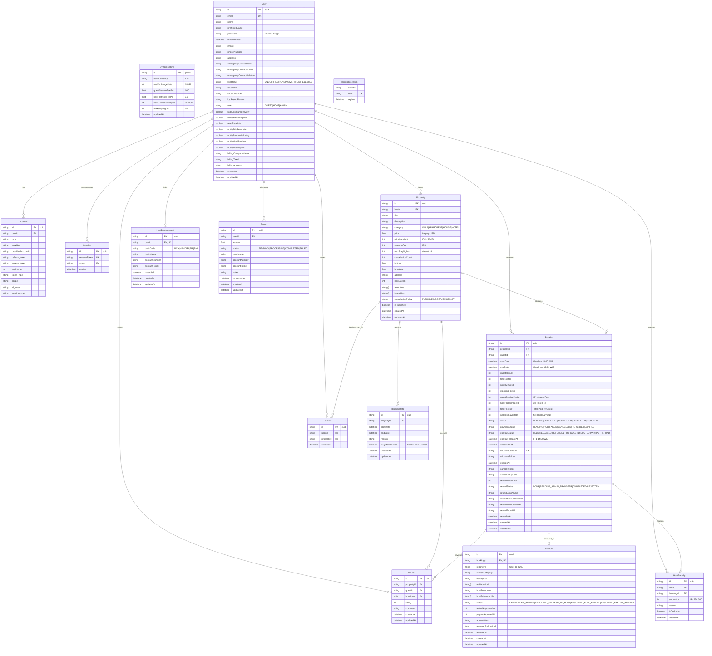
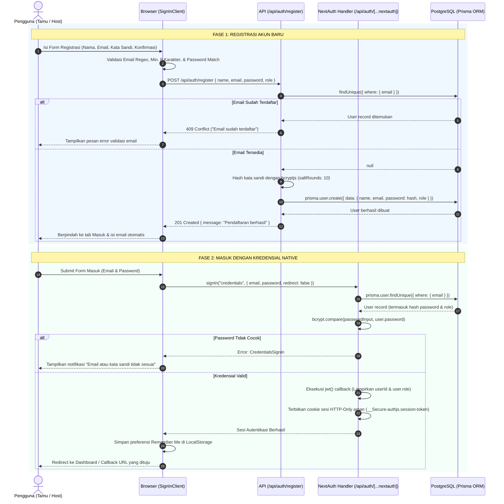
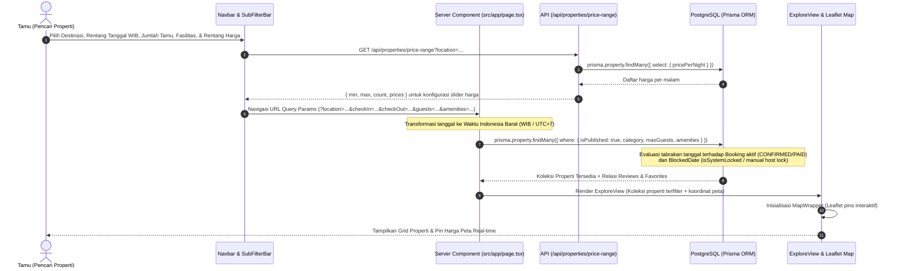
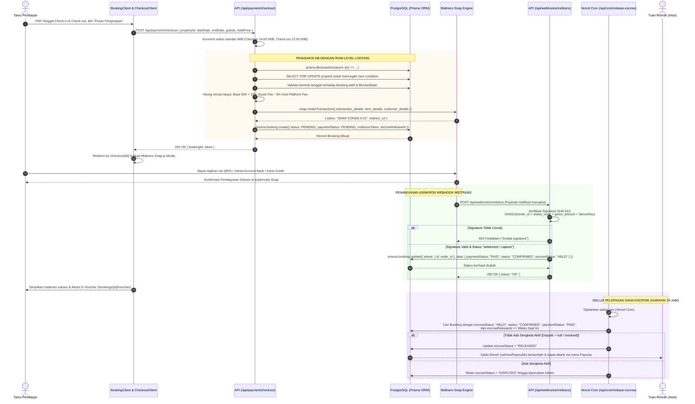

# Arsitektur Sistem - Ruang Rehat

Dokumen ini mendokumentasikan arsitektur teknis, struktur direktori, skema basis data (*Entity Relationship Diagram*), diagram alur data (*Sequence Diagram*), serta spesifikasi antarmuka API dan Server Actions pada platform **Ruang Rehat** (Airbnb Clone Indonesia).

---

## 1. Tech Stack & Struktur Direktori

### 1.1 Tech Stack

| Lapisan / Komponen | Teknologi | Keterangan & Peran |
| :--- | :--- | :--- |
| **Framework & Runtime** | Next.js 16 (App Router), Node.js, React 19 | Server-Side Rendering (SSR), React Server Components (RSC), Dynamic Server Routes, & Server Actions. |
| **Bahasa Pemrograman** | TypeScript 5 (Strict Mode) | Pengetikan statis ketat di seluruh lapisan aplikasi. |
| **Styling & Desain Sistem** | Tailwind CSS v4, Base UI, Lucide Icons | Antarmuka modern, adaptif, responsif mobile, dan mendukung tema Gelap/Terang (*dark/light mode*). |
| **Database & ORM** | PostgreSQL & Prisma ORM v5 | Skema relasional terstruktur dengan isolasi transaksi ACID dan row-level locking. |
| **Autentikasi & Sesi** | NextAuth.js v5 Beta, bcryptjs | Sesi berbasis JWT terenkripsi dengan strategi kredensial native dan integrasi adapter Prisma. |
| **Payment Gateway** | Midtrans Snap (Sandbox & Production) | Transaksi pembayaran otomatis Indonesia (QRIS, Virtual Account BCA/Mandiri/BRI/BNI, Kartu Kredit). |
| **Cloud Object Storage** | Cloudinary API | Penyimpanan aset media terdistribusi (foto properti, foto KTP KYC, bukti refund). |
| **Email Notifikasi** | Resend SDK | Pengiriman email konfirmasi reservasi dan tiket perjalanan. |
| **Pemetaan & GIS** | Leaflet & React-Leaflet | Render peta interaktif client-side berbasis koordinat lintang/bujur (Latitude/Longitude). |
| **Standarisasi Waktu & Mata Uang** | Custom Utility & date-fns | Penyelarasan Zona Waktu Indonesia Barat (WIB / UTC+7) dan *Single Source of Truth* Rupiah (IDR). |

---

### 1.2 Struktur Pohon Direktori

```text
airbnb-projects/
├── prisma/
│   ├── schema.prisma             # Definisi model entitas PostgreSQL, enum, & relasi Prisma
│   └── seed.ts                   # Skrip seeder data awal (akun demo, properti, reservasi)
├── public/                       # Berkas statis (ikon, favicon, placeholder gambar)
├── src/
│   ├── app/                      # Next.js App Router (Halaman & Endpoint API)
│   │   ├── actions/              # Next.js Server Actions (Mutasi profil, keamanan, preferensi)
│   │   ├── admin/                # Portal Tata Kelola & Audit Admin (KYC, Payout, Sengketa, Settings)
│   │   ├── api/                  # RESTful API Route Handlers
│   │   │   ├── admin/            # Endpoint operasional tata kelola admin
│   │   │   ├── auth/             # Registrasi kredensial & rute autentikasi NextAuth
│   │   │   ├── bookings/         # Pembuatan & pembatalan reservasi tamu/host
│   │   │   ├── cron/             # Endpoint terjadwal Vercel Cron (Pelepasan escrow otomatis)
│   │   │   ├── disputes/         # Pengajuan & monitoring sengketa garansi 24 jam
│   │   │   ├── favorites/        # Toggle wishlist properti
│   │   │   ├── host/             # Verifikasi rekening bank host & pengajuan payout
│   │   │   ├── kyc/              # Pengunggahan dokumen KTP & nomor identitas
│   │   │   ├── payment/          # Inisialisasi token Midtrans Snap & callback status
│   │   │   ├── properties/       # CRUD listing properti, blokir tanggal, & filter harga
│   │   │   ├── reviews/          # Ulasan dan rating pasca-menginap
│   │   │   ├── upload/           # Integrasi unggah berkas ke Cloudinary
│   │   │   ├── user/             # Ekspor data pengguna (Kepatuhan UU PDP)
│   │   │   └── webhooks/         # Webhook notifikasi pembayaran masuk dari Midtrans
│   │   ├── bookings/             # Halaman E-Voucher resmi & tiket reservasi
│   │   ├── checkout/             # Halaman transaksi pembayaran Midtrans Snap
│   │   ├── dashboard/            # Dasbor terpadu Host & Tamu (Kelola listing, pesanan, payout)
│   │   ├── profile/              # Pengaturan akun, keamanan kata sandi, & privasi
│   │   ├── properties/           # Halaman detail listing, formulir tambah & edit properti
│   │   ├── signin/               # Halaman masuk & pendaftaran akun kredensial
│   │   ├── wishlists/            # Halaman koleksi properti favorit tamu
│   │   ├── globals.css           # Konfigurasi Tailwind CSS v4 & custom stylesheet
│   │   ├── layout.tsx            # Root layout aplikasi (Navbar, Providers, Metadata)
│   │   └── page.tsx              # Halaman beranda utama & eksplorasi properti
│   ├── components/               # Komponen Antarmuka Pengguna (UI)
│   │   ├── bookings/             # Modal pembatalan pesanan & pelaporan sengketa
│   │   ├── ui/                   # Komponen primitive reusable (Dialog, Button, Input, Popover, dll)
│   │   ├── ExploreView.tsx       # Tampilan grid daftar properti & sinkronisasi peta
│   │   ├── FavoriteButton.tsx    # Tombol interaktif simpan ke wishlist
│   │   ├── ImageUpload.tsx       # Widget unggah foto Cloudinary dengan pratinjau
│   │   ├── KycModal.tsx          # Dialog verifikasi identitas KTP & NIK
│   │   ├── LogoutConfirmModal.tsx# Dialog konfirmasi keluar sesi akun
│   │   ├── Map.tsx               # Komponen Leaflet Map Container & pin harga properti
│   │   ├── MapWrapper.tsx        # Dynamic import wrapper untuk leaflet (mencegah error SSR)
│   │   ├── Navbar.tsx            # Header navigasi utama dengan menu dropdown peran
│   │   ├── NavbarSubFilters.tsx  # Kontainer sub-filter fasilitas & rentang harga
│   │   ├── PropertyCard.tsx      # Kartu visual properti dengan carousel foto
│   │   ├── SearchFilterBar.tsx   # Bar pencarian tujuan, tanggal WIB, dan jumlah tamu
│   │   ├── SearchSubFilterBar.tsx# Filter modal fasilitas lengkap & slider harga
│   │   └── ThemeProvider.tsx     # Provider tema tampilan (Light/Dark mode)
│   ├── lib/                      # Utilitas Inti & Sumber Kebenaran Tunggal (*Single Source of Truth*)
│   │   ├── amenities.ts          # Katalog fasilitas properti & metadata ikon
│   │   ├── currency.ts           # Konstanta kurs acuan USD ke IDR
│   │   ├── date-standards.ts     # Standar operasional WIB (Check-in 14:00, Check-out 12:00, Escrow 24 Jam)
│   │   ├── dictionary.ts         # Kamus lokalisasi dwi-bahasa (Bahasa Indonesia & English)
│   │   ├── format.ts             # Formatter nominal Rupiah (IDR) & estimasi USD
│   │   ├── notifications.ts      # Layanan pengiriman email transaksi via Resend
│   │   ├── prisma.ts             # Instansiasi PrismaClient Singleton (Anti koneksi bocor)
│   │   └── utils.ts              # Penggabung class CSS Tailwind (clsx & twMerge)
│   ├── auth.ts                   # Konfigurasi NextAuth v5 (Adapter, JWT Callbacks, Providers)
│   └── middleware.ts             # Middleware proteksi rute (Admin, Host, Guest dashboard)
├── .env.example                  # Template variabel lingkungan sistem
├── package.json                  # Dependensi proyek & skrip eksekusi
├── tsconfig.json                 # Konfigurasi TypeScript compiler
└── vercel.json                   # Konfigurasi Vercel Cron pelepasan escrow otomatis
```

---

## 2. Entity Relationship Diagram (ERD)

Diagram di bawah ini menggambarkan seluruh model tabel dalam basis data PostgreSQL Ruang Rehat beserta relasi kunci primer (*Primary Key*) dan kunci asing (*Foreign Key*):



---

## 3. Sequence Diagram - Alur Kritis

### 3.1 Alur Registrasi & Autentikasi User (Credentials Native)

Diagram berikut menampilkan alur pendaftaran akun baru, hashing kata sandi, serta login kredensial menggunakan NextAuth.js v5:



---

### 3.2 Alur Pencarian & Filter Properti Real-Time

Diagram berikut mengilustrasikan alur pemfilteran katalog penginapan di halaman beranda, sinkronisasi peta koordinat (Leaflet), dan penguncian tanggal berbasis WIB:



---

### 3.3 Alur Reservasi, Checkout Midtrans Snap, & Penanganan Webhook Pembayaran

Diagram berikut menjelaskan siklus lengkap pemesanan penginapan, pencegahan bentrok tanggal (*Double Booking Protection*), penerbitan token Snap, pembayaran tamu, verifikasi webhook tanda tangan SHA-512, hingga penahanan saldo *Escrow* dan jadwal pelepasan otomatis:



---

## 4. Daftar Endpoint API & Server Actions

Berikut adalah katalog lengkap seluruh rute antarmuka pemrograman (*Application Programming Interface*) dan aksi peladen (*Server Actions*) yang beroperasi di dalam sistem Ruang Rehat:

### 4.1 Autentikasi & Akun Pengguna

| Metode | Endpoint / Server Action | Otorisasi Akses | Deskripsi & Kegunaan |
| :--- | :--- | :--- | :--- |
| `POST` | `/api/auth/register` | Publik | Mendaftarkan akun pengguna baru dengan validasi email, keamanan kata sandi minimal 8 karakter, dan pencegahan duplikasi. |
| `GET/POST`| `/api/auth/[...nextauth]` | Publik | Endpoint inti NextAuth.js v5 untuk sesi, penanganan login kredensial native, dan callback JWT token. |
| `POST` | `/api/kyc/submit` | Pengguna Login | Mengunggah dokumen foto KTP dan mencatat Nomor Induk Kependudukan (NIK) untuk verifikasi KYC. |
| `GET` | `/api/user/export-data` | Pengguna Login | Mengunduh seluruh rekam jejak akun (profil, transaksi, ulasan, rekening bank) dalam format JSON sesuai hak akses UU Perlindungan Data Pribadi (UU PDP). |
| `ACTION` | `updateProfile(formData)` | Pengguna Login | Server Action untuk memperbarui data identitas pribadi, nomor telepon, kontak darurat, serta preferensi bahasa & mata uang ke cookies. |
| `ACTION` | `changeEmail(newEmail, pwd)` | Pengguna Login | Server Action untuk memvalidasi keamanan kata sandi dan memperbarui alamat email akun pengguna. |
| `ACTION` | `changePassword(oldPwd, newPwd)` | Pengguna Login | Server Action untuk memverifikasi kata sandi lama dan menyimpan hash kata sandi baru (bcrypt). |
| `ACTION` | `updatePrivacySettings(data)` | Pengguna Login | Server Action untuk mengubah visibilitas nama belakang pada ulasan dan preferensi indeks mesin pencari. |
| `ACTION` | `updateNotificationSettings(data)` | Pengguna Login | Server Action untuk mengatur preferensi notifikasi reservasi, pengingat menginap, dan pemasaran. |
| `ACTION` | `updateBusinessBilling(data)` | Pengguna Login | Server Action untuk menyimpan data NPWP perusahaan, nama entitas bisnis, dan alamat faktur pajak. |

---

### 4.2 Properti & Eksplorasi

| Metode | Endpoint | Otorisasi Akses | Deskripsi & Kegunaan |
| :--- | :--- | :--- | :--- |
| `GET` | `/api/properties` | Publik | Mengambil katalog properti yang telah dipublikasikan (`isPublished: true`) beserta rata-rata ulasan. |
| `POST` | `/api/properties` | Host (Terautentikasi) | Menambahkan listing properti baru ke database dengan rincian fasilitas, koordinat GIS, dan harga dasar IDR. |
| `GET` | `/api/properties/[id]` | Publik | Mengambil data lengkap satu properti spesifik beserta kalender ketersediaan tanggalnya. |
| `PUT` | `/api/properties/[id]` | Host Pemilik | Memperbarui informasi judul, deskripsi, harga sewa, biaya kebersihan, maupun foto properti. |
| `DELETE` | `/api/properties/[id]` | Host Pemilik | Menghapus listing properti dari sistem secara permanen beserta dependensinya. |
| `GET` | `/api/properties/price-range` | Publik | Menghitung harga minimum, maksimum, dan distribusi statistik tarif properti di suatu wilayah untuk batas filter pencarian. |
| `GET` | `/api/properties/blocked-dates` | Publik | Mengambil daftar tanggal yang terkunci/tidak tersedia pada suatu properti. |
| `POST` | `/api/properties/blocked-dates` | Host Pemilik | Menambahkan tanggal blokir kustom secara manual agar unit tidak dapat dipesan tamu. |
| `DELETE` | `/api/properties/blocked-dates` | Host Pemilik / Admin | Membuka kembali tanggal yang diblokir (Tanggal yang dikunci otomatis oleh sistem akibat sanksi pembatalan sepihak hanya dapat dibuka oleh Admin). |
| `POST` | `/api/favorites` | Tamu (GUEST) | Menambahkan atau mencopot properti dari daftar favorit (*Wishlist*) pengguna. |
| `POST` | `/api/upload` | Pengguna Login | Mengunggah berkas foto secara langsung ke Cloudinary API dan mengembalikan URL HTTPS publik. |

---

### 4.3 Reservasi, Transaksi, & Pembayaran

| Metode | Endpoint | Otorisasi Akses | Deskripsi & Kegunaan |
| :--- | :--- | :--- | :--- |
| `GET` | `/api/bookings` | Pengguna Login | Mengambil riwayat pemesanan milik tamu aktif atau reservasi yang masuk ke properti milik host aktif. |
| `POST` | `/api/payment/checkout` | Tamu (GUEST) | Memvalidasi ketersediaan tanggal, mengenakan row-level lock anti-double booking, menghitung *split-fee*, membuat pesanan status `PENDING`, dan meminta Snap Token dari Midtrans. |
| `POST` | `/api/payment/success` | Tamu (GUEST) | Endpoint pembaruan status cadangan (*client fallback*) saat tamu menyelesaikan transaksi di antarmuka Midtrans Snap. |
| `POST` | `/api/webhooks/midtrans` | Midtrans Server | Menerima dan memproses callback notifikasi pembayaran resmi dari Midtrans dengan verifikasi SHA-512 signature key. |
| `POST` | `/api/bookings/[id]/cancel` | Tamu / Host | Membatalkan reservasi. Jika dibatalkan sepihak oleh Host: mengenakan sanksi denda Rp 250.000, mengunci kalender tanggal tersebut, dan mengembalikan 100% dana tamu ke antrean refund manual. |
| `POST` | `/api/reviews` | Tamu (GUEST) | Memberikan ulasan teks dan rating bintang (1–5) untuk properti yang telah selesai dikunjungi. |
| `GET` | `/api/cron/release-escrow` | Vercel Cron / Admin | Mengeksekusi rilis dana escrow tertahan ke saldo dompet host secara otomatis setelah melewati jendela garansi 24 jam sejak check-in resmi (14:00 WIB). |

---

### 4.4 Rekening Bank & Penarikan Saldo Host (Payouts)

| Metode | Endpoint | Otorisasi Akses | Deskripsi & Kegunaan |
| :--- | :--- | :--- | :--- |
| `GET` | `/api/host/bank-account` | Host (Terautentikasi) | Mengambil informasi rekening bank pencairan yang terdaftar atas nama Host. |
| `POST` | `/api/host/bank-account` | Host (Terautentikasi) | Mendaftarkan atau memperbarui rekening bank pencairan host (BCA, Mandiri, BRI, BNI). |
| `POST` | `/api/host/bank-account/inquiry` | Host (Terautentikasi) | Simulasi verifikasi nama pemilik rekening bank sebelum proses penarikan dana dieksekusi. |
| `GET` | `/api/host/payouts` | Host (Terautentikasi) | Melihat riwayat permohonan penarikan dana host beserta status auditnya. |
| `POST` | `/api/host/payouts` | Host Terverifikasi KYC | Mengajukan penarikan saldo sewa yang telah berstatus *RELEASED* ke rekening bank host yang terverifikasi. |

---

### 4.5 Pengaduan Sengketa (Disputes)

| Metode | Endpoint | Otorisasi Akses | Deskripsi & Kegunaan |
| :--- | :--- | :--- | :--- |
| `GET` | `/api/disputes` | Pengguna Login | Mengambil daftar sengketa aktif milik pengguna (Tamu pelapor atau Host pemilik listing). |
| `POST` | `/api/disputes` | Tamu (GUEST) | Mengajukan klaim komplain dalam jendela waktu 24 jam sejak check-in resmi (disertai foto bukti & kategori keluhan). Pengajuan ini otomatis menahan dana escrow agar tidak cair ke host. |

---

### 4.6 Portal Tata Kelola & Audit Admin

| Metode | Endpoint | Otorisasi Akses | Deskripsi & Kegunaan |
| :--- | :--- | :--- | :--- |
| `PATCH` | `/api/admin/kyc/[id]` | Khusus ADMIN | Menyetujui (*VERIFIED*) atau menolak (*REJECTED*) pengajuan verifikasi KTP dan NIK host beserta catatan alasan penolakan. |
| `PATCH` | `/api/admin/payouts/[id]` | Khusus ADMIN | Memperbarui status pencairan dana host menjadi `PROCESSING`, `COMPLETED`, atau `FAILED`. |
| `GET` | `/api/admin/refunds` | Khusus ADMIN | Mengambil daftar seluruh antrean pengembalian dana tamu (akibat pembatalan sepihak atau sengketa). |
| `PATCH` | `/api/admin/refunds/[id]` | Khusus ADMIN | Menyelesaikan status transfer pengembalian dana tamu secara manual dan melampirkan URL bukti transfer bank. |
| `PATCH` | `/api/admin/disputes/[id]` | Khusus ADMIN | Mengambil keputusan hukum sengketa: melepaskan dana ke host, mengembalikan dana penuh ke tamu, atau resolusi bagi hasil parsial (*Partial Refund*). |
| `PATCH` | `/api/admin/users/[id]/role` | Khusus ADMIN | Mengubah hak peran pengguna secara dinamis antara `GUEST`, `HOST`, atau `ADMIN` (dengan proteksi anti self-demote admin). |
| `GET` | `/api/admin/settings` | Khusus ADMIN | Mengambil parameter operasional global dari tabel `SystemSetting`. |
| `PATCH` | `/api/admin/settings` | Khusus ADMIN | Memperbarui parameter kurs acuan USD, persentase split-fee tamu/host, nominal denda pembatalan, dan batas maksimum durasi sewa. |
